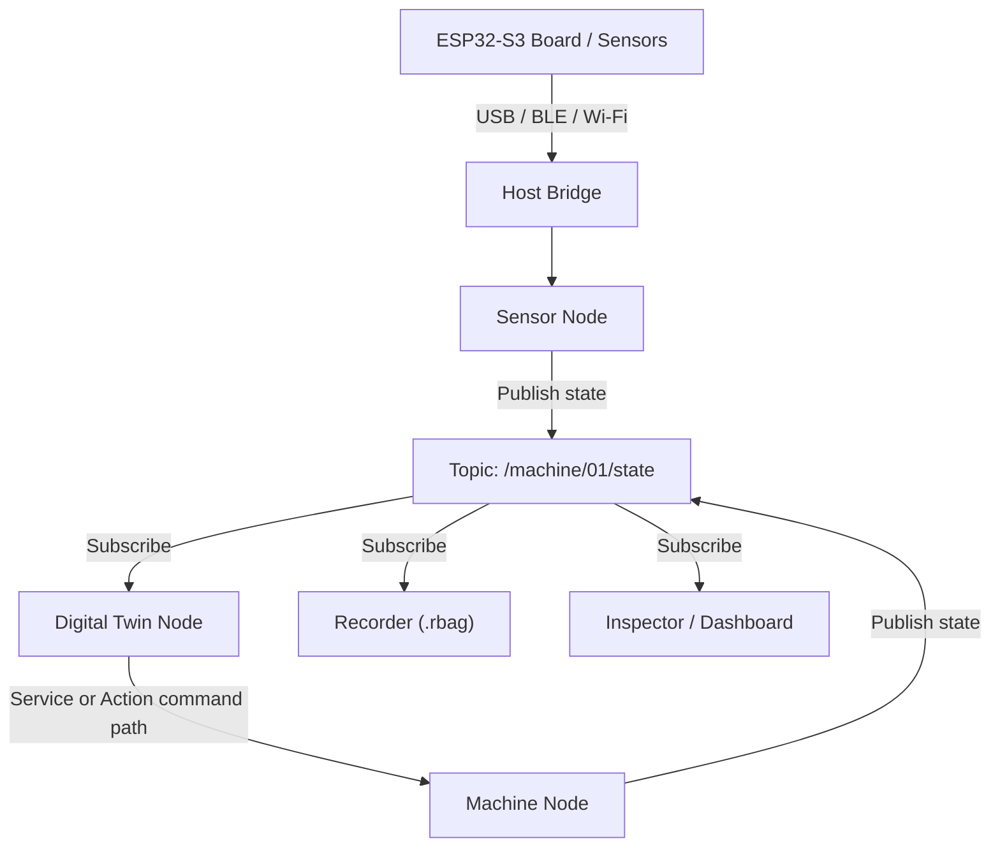

# KMUTT ND69 — ND03 Learning Summary

บันทึกสรุปความรู้หลักสูตร ND03 ด้าน Automation, Robotics และ Digital Twin จากเอกสารของผู้สอน

**แหล่งข้อมูลต้นฉบับ:** https://github.com/drsanti/kmutt-nd69/tree/main/nd3/docs

> หมายเหตุ: เอกสารนี้เป็นสรุปจากเอกสารการสอน ไม่ใช่หลักฐานว่าผู้จัดทำได้ทดสอบ Workshop ทุกชุดแล้ว สามารถเพิ่มเติมผลการทดลอง ภาพประกอบ และข้อสังเกตของตนเองได้

## สรุปแต่ละสัปดาห์

| Week | หัวข้อ | สาระสำคัญ |
|---|---|---|
| [01](https://github.com/drsanti/kmutt-nd69/tree/main/nd3/docs/week01) | Introduction | ภาพรวมหลักสูตร Automation, Robotics และ Machinery Industry |
| [02](https://github.com/drsanti/kmutt-nd69/tree/main/nd3/docs/week02) | ROS-style Middleware & Digital Twin | Node, Topic, Message, Service, Action, Parameter, TF, QoS และ Digital Twin รวม 11 บท |
| [03](https://github.com/drsanti/kmutt-nd69/tree/main/nd3/docs/week03) | Hands-on with robotos | Workshop Python 7 ชุดและ Mini Digital Twin |
| [04](https://github.com/drsanti/kmutt-nd69/tree/main/nd3/docs/week04) | The Real Board | ร่าง Workshop เชื่อมบอร์ดจริงกับ robotos graph |
| [05](https://github.com/drsanti/kmutt-nd69/tree/main/nd3/docs/week05) | ยังไม่มีเอกสารเนื้อหา | โฟลเดอร์ยังมีเพียง .gitkeep |
| [06](https://github.com/drsanti/kmutt-nd69/tree/main/nd3/docs/week06) | Self-learning & Mini-Project #1 | สรุป Week 01–05 ด้วย Markdown และส่ง GitHub Repository แบบ Public |

## Week 01 — Introduction

แนะนำการประยุกต์เทคโนโลยี Automation, Robotics และ Machinery Industry เพื่อเตรียมพื้นฐานสำหรับการเรียน Middleware และ Digital Twin ในสัปดาห์ต่อไป

[สไลด์ Week 01](https://canva.link/k6nsimyqdiyxlyn)

## Week 02 — ROS-style Middleware & Digital Twin

1. **Why ROS and Digital Twin?** เปลี่ยนจากระบบควบคุมแบบรวมศูนย์สู่ระบบที่แยกองค์ประกอบ เชื่อม Sensor, Robotics, Edge และ AI ได้ยืดหยุ่น
2. **The Graph:** Node คือหน่วยงานอิสระ; Topic คือช่องข้อมูลแบบ Publish/Subscribe; Graph คือความสัมพันธ์ของ Node ทั้งระบบ
3. **Messages & Schema:** กำหนดชนิดข้อมูล ชื่อ Field ความหมาย หน่วย และ Version ร่วมกัน
4. **Services & Actions:** Service ใช้กับ Request/Response ระยะสั้น ส่วน Action เหมาะกับงานที่ใช้เวลา มี Feedback และ Cancel
5. **Parameters & Lifecycle:** ตั้งค่าระหว่าง Runtime และจัดการสถานะของ Node เช่น Unconfigured, Inactive และ Active
6. **TF Frames:** แปลงพิกัดระหว่าง Camera, Robot Base และ World Frame
7. **Observe & Debug:** ตรวจ Graph, ดู Message และบันทึก/เล่นข้อมูลย้อนหลัง
8. **QoS & Determinism:** เลือกความน่าเชื่อถือ/ความสดของข้อมูลให้เหมาะสม และแยก Hard Real-time Control ออกจาก Network Pub/Sub
9. **Digital Twin:** ตัวแทนดิจิทัลที่เชื่อมกับเครื่องจริงและรับ State อย่างต่อเนื่อง
10. **Twin Meets Middleware:** Twin Subscribe สถานะเครื่อง ใช้ทดลอง What-if และ Virtual Commissioning รวมถึงออกแบบ Command Path กลับอย่างปลอดภัย
11. **C, Rust, Python:** แนวคิดการสื่อสารเดียวกันสามารถประยุกต์ผ่าน SDK/Interface ต่างภาษาได้

**ข้อควรจำ:** `robotos` ใช้แนวคิดคล้าย ROS 2 แต่ไม่ใช่ ROS 2 โดยตรง; Pseudo-API ในบทเรียนแนวคิดไม่จำเป็นต้องตรงกับ SDK ที่ใช้งานจริง

[อ่าน 11 บทเรียน](https://github.com/drsanti/kmutt-nd69/tree/main/nd3/docs/week02/lessons)

## Week 03 — Hands-on with robotos

Workshop ทำบน Laptop ได้โดยไม่ต้องต่อบอร์ดจริง ใช้ Python 3.10 ขึ้นไป, `robotos 0.3.0` และ Zenoh เป็น Transport โดยค่าเริ่มต้น

| Lab | สิ่งที่ฝึก | ตัวอย่าง |
|---|---|---|
| 01 | ติดตั้ง CLI และเปิด Inspector | `robotos version`, `robotos doctor`, `robotos ui` |
| 02 | Publish/Subscribe | `02-sim_sensor.py`, `02-monitor.py` |
| 03 | Service Request/Response | `03-echo_server.py`, `03-client.py` |
| 04 | Action Goal/Feedback/Cancel | `04-cycle_server.py`, `04-cycle_client.py` |
| 05 | Parameter Get/Set/Save/Load | `05-tuning_node.py` |
| 06 | Record & Replay | `.rbag`, `robotos record`, `robotos play` |
| 07 | Mini Digital Twin | `07-machine.py`, `07-twin.py` |

Windows ให้ใช้ **PowerShell** ไม่ใช่ Git Bash และใช้ Python จาก Virtual Environment ที่ติดตั้ง SDK

ตัวอย่างคำสั่งจากคู่มือ:

```powershell
robotos version
robotos doctor
robotos ui
robotos node list
robotos topic list
robotos topic echo /machine/01/sensor/imu
robotos record /machine/01/sensor/imu -o machine_run.rbag --duration-s 10
robotos bag info machine_run.rbag
robotos play machine_run.rbag
```

Inspector ใช้ที่ `http://127.0.0.1:4789` บนเครื่องเดียวกัน

[คู่มือ Workshop และ Code](https://github.com/drsanti/kmutt-nd69/tree/main/nd3/docs/week03/workshops)

## Week 04 — The Real Board (Draft)

ร่าง Workshop เน้นการเชื่อมบอร์ด ESP32-S3 กับ Graph ที่เรียนมา ได้แก่:

1. การค้นหา Node ของบอร์ดและ Presence
2. การอ่าน Process Variables เช่น Battery, IMU หรือ Microphone Level (ขึ้นกับชนิดบอร์ด)
3. การสั่ง LED และ Sound Effect
4. Parameters ที่เก็บค่าข้าม Reboot ได้
5. Button Events เช่น Short/Long Press
6. Record Topic จากบอร์ดจริง
7. Mini Digital Twin II ระหว่าง Live และ Replay

**สถานะ:** เอกสารต้นฉบับเป็น Draft Outline ไม่ใช่คู่มือ Workshop ฉบับสมบูรณ์

## Week 05 — รอเนื้อหา

ยังไม่มีเนื้อหาบทเรียนให้ตรวจสอบในโฟลเดอร์ต้นฉบับ จึงเว้นไว้เพื่อเติมตามการเรียนจริง

## Week 06 — Self-learning & Mini-Project #1

นำความรู้ Week 01–05 มาสรุปเป็น `README.md` บน GitHub ฝึกการใช้ Git, GitHub Desktop, Commit และ Push ตรวจว่า Repository เป็น Public จากนั้นส่ง URL ผ่าน [แบบฟอร์มส่งงาน](https://forms.gle/pDp1SkyJ14mVRvfK7)

[GitHub Hands-on Guide](https://github.com/drsanti/github-hands-on)

## ภาพรวมสถาปัตยกรรมที่หลักสูตรสอน

ND03 เน้นการออกแบบระบบแบบ **Distributed Middleware** โดยแยก Sensor, Machine, AI, Digital Twin, Recorder และ Inspector เป็น **Nodes** ที่เชื่อมต่อกันผ่าน Graph และส่งข้อมูลโดยใช้ Topic, Service และ Action ตามลักษณะของงาน

### แผนภาพสถาปัตยกรรม



ภาพนี้สรุปแนวคิดของหลักสูตร ไม่ใช่แผนผังระบบที่ทดลองเชื่อมต่อจริงครบทุกส่วนแล้ว โดย **robotos runtime** จัดการ Graph, Topics, Services, Actions, Parameters และ Presence ส่วน **Zenoh** เป็น Transport ตามค่าเริ่มต้น

### รูปแบบการสื่อสาร

| รูปแบบ | หลักการ | ตัวอย่างในโรงงาน |
|---|---|---|
| **Topic** | Publish/Subscribe ข้อมูลต่อเนื่อง | Sensor, Machine State, Telemetry |
| **Service** | Request/Response สำหรับงานสั้น | อ่านสถานะ, Reset Counter |
| **Action** | Goal/Feedback/Result/Cancel สำหรับงานยาว | Homing, Machine Cycle |
| **Parameter** | ตั้งค่าที่มีเจ้าของเป็น Node | Threshold, Setpoint, Sampling Rate |
| **Presence** | ตรวจสอบ Node ที่อยู่ใน Graph | Station Alive / Watchdog |
| **Recorder/Replay** | บันทึกและเล่น Topic Stream ซ้ำ | Historian, Debug, Regression Test |
| **Digital Twin** | Node ที่สะท้อนข้อมูลจากเครื่องจริง | Shadow Monitoring, Virtual Commissioning |

### แนวคิดสำคัญ

- **Node** ทำหน้าที่เฉพาะและไม่จำเป็นต้องเรียกโปรแกรมอื่นโดยตรง
- **Topic** กระจายข้อมูลชุดเดียวไปยังผู้รับหลายรายได้
- **Service** เหมาะกับคำสั่งที่เสร็จและตอบกลับเร็ว ส่วน **Action** เหมาะกับงานที่ต้องติดตามความคืบหน้าและยกเลิกได้
- **Digital Twin** รับข้อมูลจริงเพื่อติดตามและจำลองการทำงาน แต่ไม่ใช่ตัวแทนระบบ Safety
- วงจร **Hard Real-time**, PID, E-stop และ Safety Interlock ควรอยู่ใน Controller/ระบบความปลอดภัยที่เหมาะสม ไม่พึ่ง Network Pub/Sub เป็นวงจรควบคุมหลัก

**อ้างอิง:** [Week 02 — บทเรียน](https://github.com/drsanti/kmutt-nd69/tree/main/nd3/docs/week02/lessons) · [Week 03 — System Overview](https://github.com/drsanti/kmutt-nd69/blob/main/nd3/docs/week03/SYSTEM-OVERVIEW.md)

---

## ความเชื่อมโยงกับงานอุตสาหกรรม

| แนวคิด ND03 | การประยุกต์ |
|---|---|
| Node / Topic | Sensor Data Distribution และ Machine Monitoring |
| Message Schema | Data Contract ระหว่าง PLC Gateway, Vision และ Dashboard |
| Service / Action | Machine Command และ Sequence ที่ตรวจ Feedback ได้ |
| Parameters | Setpoint / Configuration Management |
| Record / Replay | Historian, Debugging, Regression Test |
| Digital Twin | Virtual Commissioning และ What-if Simulation |

**ข้อควรระวัง:** ไม่ควรย้าย Safety Interlock, E-Stop, PID หรือวงจร Hard Real-time มาอาศัย Network Pub/Sub แทน Controller ที่ออกแบบไว้โดยเฉพาะ

## Experiment Log — ผลการทดลองจริง (รอเพิ่มเติม)

| Workshop | วันที่ | ผลการทดสอบ | ปัญหา / วิธีแก้ | หลักฐาน |
|---|---|---|---|---|
| W03-01 | — | ยังไม่ได้บันทึก | — | — |
| W03-02 | — | ยังไม่ได้บันทึก | — | — |
| W03-03 | — | ยังไม่ได้บันทึก | — | — |
| W03-04 | — | ยังไม่ได้บันทึก | — | — |
| W03-05 | — | ยังไม่ได้บันทึก | — | — |
| W03-06 | — | ยังไม่ได้บันทึก | — | — |
| W03-07 | — | ยังไม่ได้บันทึก | — | — |
| W04 Board | — | ยังไม่ได้บันทึก | — | — |

---

*เอกสารเรียบเรียงจากแหล่งอ้างอิงเพื่อการศึกษา โปรดเติมประสบการณ์การทดลองของผู้จัดทำก่อนส่งเป็นรายงานส่วนบุคคล*
